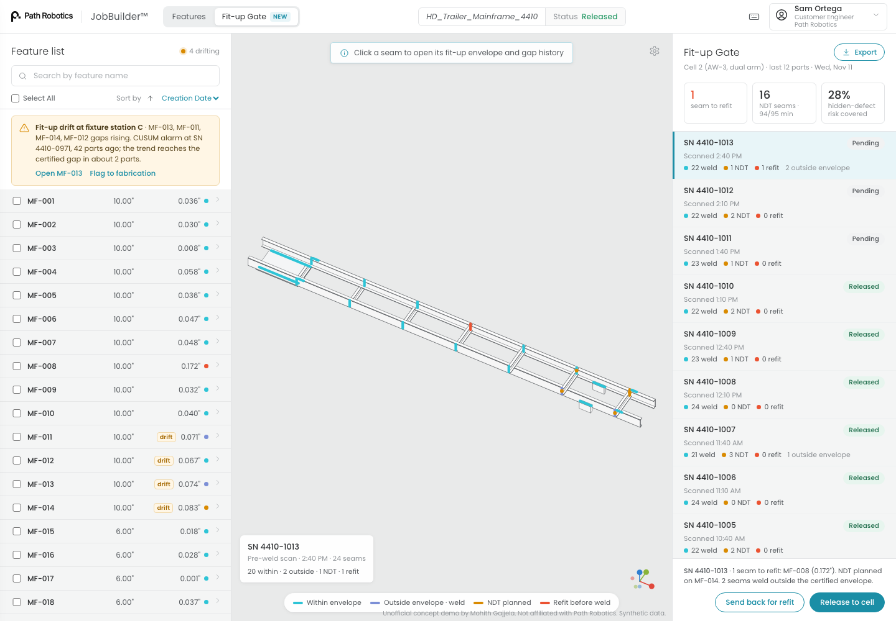

# Fit-up Gate for Path Robotics JobBuilder (concept)

**Live demo:** https://mohith26.github.io/path-robotics-fitup-gate/

Obsidian already scans every seam before it welds, so Path knows each joint's real root gap on every part. Fit-up Gate turns those scans into three decisions a fabricator cares about: **how big a gap this cell can weld and still certify a target defect rate**, **which seams on today's parts should be re-fit or sent to NDT** within a fixed inspection budget, and **when a fixture or cutting process upstream has started drifting**, before its parts leave the envelope. It lives in JobBuilder as a new *Fit-up Gate* view next to the feature list, and as a *Fit-up* tab on each feature.



*Unofficial concept demo by Mohith Gajjela. Not affiliated with Path Robotics. All data is synthetic (seeded script in `data/generate.mjs`).*

## Why this, for Path

- Path's pitch is "perfect welds from imperfect parts" and "no perfect fit-up required". The natural next question from a customer quality team (and from HII-style contracts that are contingent on quality performance) is *how imperfect* is fine, with evidence.
- AWS D1.1 only says what is legal for fillet welds: up to 1/16 in weld as detailed, 1/16 to 3/16 in increase the leg by the gap, over 3/16 in not permitted. It says nothing about what a given cell actually welds well inside that band.
- Field roles at Path list "track cell performance and part fit-up" and reviewing NDT data as manual work. This makes that tracking automatic and turns it into decisions.

## How it works

| Piece | Method | Guarantee / property |
|---|---|---|
| Fit-up envelope per joint class (joint type x leg size) | Defect rate per 0.2 mm gap bin from fleet history; isotonic (PAVA) fit; simultaneous one-sided upper band = Clopper-Pearson on every bin interval at level delta / #intervals, then running minimum from the right | If the defect rate never falls as the gap opens, then with probability >= 1 - delta, **every gap below the certified gap has a defect rate <= tau**, simultaneously (Bonferroni over intervals; pooled-binomial validity via Hoeffding 1956) |
| Refit or weld | Expected cost: refit when (rate at this gap - rate at nominal) x repair cost > refit cost; always refit over 3/16 in (D1.1) | Bayes-optimal under the point estimate and the stated costs |
| NDT plan for the shift | Exact 0/1 knapsack (DP over half-minutes) maximizing expected scan-invisible defects found within the minute budget | Optimal for the budget given the risks |
| Fixture / cutting drift | One-sided CUSUM per seam on robust z-scores (median / MAD reference from first-article parts, clipped at 3), threshold calibrated with a Brook-Evans Markov chain on the empirical z distribution to one false alarm per 100,000 parts per seam; Theil-Sen trend to forecast parts until the certified gap | Calibrated in-control run length; outlier-robust trend |
| AWS D1.1 leg upsizing | Required leg = detailed leg + gap when gap > 1/16 in | Matches D1.1 clause 7.21.1 (2020 and 2025 editions) |

## Results (from `data/results.json`, seed 20261111)

The simulated cell has a part-level first-pass yield of 96.9% after code-mandated refits, close to Path's published "97%+". 40% of weld defects are assumed invisible to the post-weld scan (root fusion); NDT finds 90% of what it is pointed at.

| NDT policy (1,000 simulated shifts, 12,000 parts) | Minutes per part | Share of scan-invisible defects caught | Escapes per 1,000 parts |
|---|---|---|---|
| Random 5% spot checks | 7.8 | 3% | 13.0 |
| Inspect every seam over 1/16 in | 8.1 | 49% | 6.8 |
| **Fit-up Gate (knapsack, same minutes as spot checks)** | **7.8** | **53%** | **6.3** |
| Oracle (true risk, same minutes) | 7.8 | 53% | 6.3 |

| Other results | Value |
|---|---|
| Certified gap at 1% / 95% (fillet T 5/16 in), true limit in the simulator | 0.071 in (1.8 mm) vs 2.46 mm true: conservative, never above the truth |
| Cost-based refit vs code-only refit (USD per part, refit $35, repair $420) | $10.12 vs $13.38; defects 1.97 vs 3.08 per 100 parts |
| Drift of +0.008 mm per part on station C (300 runs): CUSUM median delay | 43 parts (p90 51), 0.7% false alarms in the 150 in-control parts before onset |
| Same drift, naive 3-sigma individuals chart | 99% of runs false-alarm before the drift starts (scan gaps have heavy tails) |
| Lead time: CUSUM alarm vs mean gap leaving the envelope | 84 parts earlier |
| NDT while station C has drifted +0.6 mm (500 shifts): 1/16 in gap rule vs gate | 15.1 vs 7.8 min per part; catches 58% vs 51% |

The gate matches the oracle because the isotonic risk ranking is essentially the true ranking; the realistic gap to a fixed 1/16 in rule is small in steady state (+4 points at 4% fewer minutes). The gate's real advantages are that its minutes are fixed by budget (the gap rule's NDT minutes nearly double once fit-up drifts, see table), it is joint-class aware, and the envelope and drift alarm are evidence a customer quality team can sign.

## The app

- **Fit-up Gate view** (`#`): feature list with each seam's scanned gap and decision, 3D part view with seams colored by decision (click a seam), gate queue for the last 12 scanned parts with refit / NDT counts, Release to cell and Send back for refit (persisted in localStorage), CSV export of every seam decision.
- **Fit-up tab** on a feature (`#part=4410-1013&feature=MF-013&tab=fitup`): envelope chart with D1.1 zones, this part's verdict and required leg, gap history with CUSUM and forecast.
- **Settings** (gear): target defect rate, confidence, NDT budget and costs; everything recomputes in the browser.
- **Features view**: the plain JobBuilder feature list and model, as today.
- Keyboard: `J`/`K` parts, `[`/`]` features, `/` search, `R` release, `B` send back, `E` export, `Esc` close, `?` help.

## Run and test

```
python3 -m http.server 8000      # then open http://localhost:8000
node data/generate.mjs           # regenerates data/job.json and data/results.json deterministically
node --test test/*.test.mjs      # 15 tests
```

Tests cover Clopper-Pearson against closed forms, incomplete-beta symmetry (randomized), PAVA properties (randomized), band monotonicity, **simultaneous coverage by simulation**, certified-gap logic, D1.1 rules, knapsack optimality against brute force (randomized), NDT budget, Brook-Evans ARL against simulation and the Siegmund value, Theil-Sen, CSV escaping, determinism of the data script against the committed results, and recomputation of the headline numbers. CI runs them on every push.

## Honest limitations

- All data is synthetic. Defect-vs-gap curves are logistic shapes I chose so the cell's yield matches Path's published first-pass yield; real curves depend on WPS, position, material, wire and Obsidian's own adaptation (which already widens the envelope).
- Certification pools fleet history per joint class across cells. That assumes cells running the same WPS share a curve; per-cell certification would need local data or a hierarchical model.
- The guarantee is per 0.2 mm bin and relies on monotonicity in gap; it ignores other fit-up features (mismatch, gap variation along the seam, tack locations) that Path's scans also capture. A multi-feature version would need a monotone model in several variables.
- "Invisible share" and NDT sensitivity are assumptions, not measurements. The NDT plan is exact for a whole shift but static; an online version would allocate as parts arrive.
- The gate cannot see Obsidian's internals; in production, Obsidian's own predicted weld quality would be a better risk input than gap alone.

## Prior art and novelty

- Path Robotics pages (Obsidian, Intelligent Welding Cells, Multi-Pass Adaptive Fill, JobBuilder walkthrough, Mission Control, careers) describe adapting to fit-up in real time, post-weld inspection, and human tracking of part fit-up; I found no customer-facing fit-up envelope, gate, NDT plan or drift alarm.
- Adaptive welding to gap is well established (Servo-Robot seam sensors in TWI work, Novarc's adaptive pipe-gap controller). Patent US20230056400A1 describes using measured pre-weld gap and bead profiles to classify welds as conforming, including Bayesian estimates. What is new here is the combination: a finite-sample, simultaneous certified gap limit, budget-optimal NDT targeting, and calibrated drift detection, wired into Path's existing scan data and JobBuilder.
- Isotonic regression, Clopper-Pearson, CUSUM (Page 1954), Brook-Evans (1972) and Theil-Sen are standard; the contribution is applying them to this decision.
